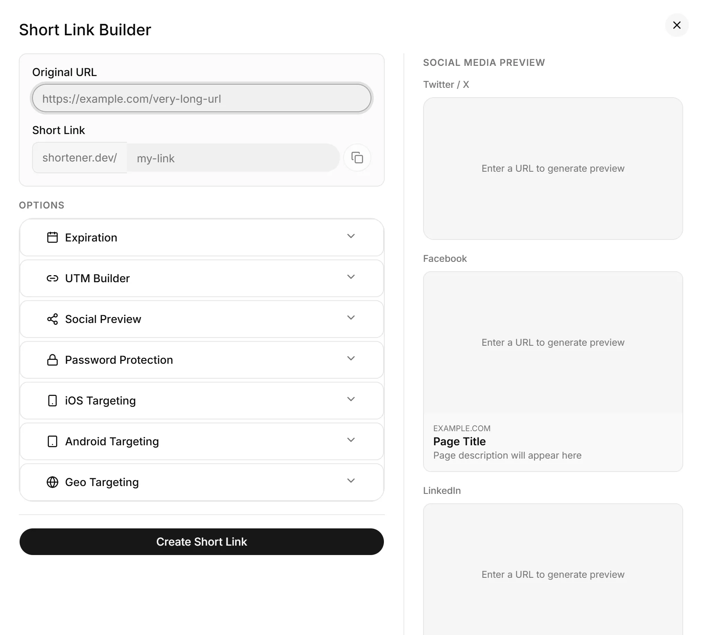

<p align="center">
  <a href="https://shortener.dev">
    
  </a>
</p>

# shortener-app

The dashboard for [Shortener.dev](https://shortener.dev), served at [app.shortener.dev](https://app.shortener.dev). A React single-page app built with Vite, Tailwind CSS and shadcn/ui (Base UI), deployed as static assets on Cloudflare Workers.

<picture>
  <source media="(prefers-color-scheme: dark)" srcset="../web/public/images/app-create-dark.webp">
  
</picture>

## Scripts

```bash
npm run dev          # http://localhost:5173
npm run build        # production build into dist/
npm run build:dev    # development build
npm run preview      # serve the build locally
npm run lint
npm run test         # vitest
```

Deploy with `npm run build && npx wrangler deploy`. [`wrangler.json`](wrangler.json) serves `dist/` with single-page app fallback.

## Configuration

[`src/env.ts`](src/env.ts) holds the settings that differ between environments:

| Setting         | Development                | Production                     |
| --------------- | -------------------------- | ------------------------------ |
| `API_URL`       | `http://localhost:8787/v1` | `https://api.shortener.dev/v1` |
| `RECAPTCHA_KEY` | reCAPTCHA site key         | reCAPTCHA site key             |
| `SHORT_DOMAIN`  | `srt1.link`                | `srt1.link`                    |

Run the [API](../api/README.md) alongside it, or run everything from the repository root with `npm run dev`.

## Layout

| Path                  | Contents                                                                  |
| --------------------- | ------------------------------------------------------------------------- |
| `src/app/`            | Pages: links, domains, analytics, reports, users, settings, billing, auth |
| `src/app/domains/`    | Add and verify domains (email code or Google Search Console)              |
| `src/components/ui/`  | shadcn/ui components                                                      |
| `src/lib/api.ts`      | API client                                                                |
| `src/hooks/`          | Auth, reCAPTCHA and view preference hooks                                 |
| `src/types/`          | API response types                                                        |

## Domain verification

Links can only point to verified or whitelisted domains, which keeps short links from being used for phishing and protects domain owners. The **Domains** page lets users add a domain and verify it. See [Responsible link shortening](../../README.md#responsible-link-shortening) and [Verify a domain](https://shortener.dev/docs/verify-domain).

## License

[AGPLv3](../../LICENSE). Built for [shortener.dev](https://shortener.dev).
