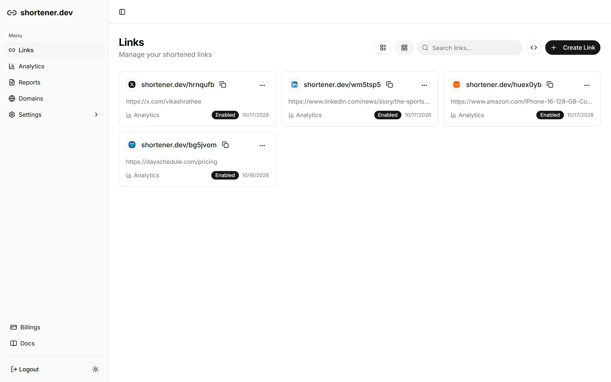

<p align="center">
  <a href="https://shortener.dev">
    
  </a>
</p>

# shortener-web

Marketing website for [shortener.dev](https://shortener.dev): TanStack Start (SSR) on Cloudflare Workers, Tailwind and shadcn (Base UI) with the same theme tokens as `apps/app`.

<picture>
  <source media="(prefers-color-scheme: dark)" srcset="public/images/app-links-dark.webp">
  
</picture>

```bash
npm run dev          # http://localhost:3000, runs in workerd via @cloudflare/vite-plugin
npm run build        # dist/client (assets) + dist/server (worker)
npm run deploy       # build, then wrangler deploy
npm run check-types
```

## Layout

- `src/routes/` file routes. Every route sets `head()` through `seo()` in `src/lib/seo.ts` (title, description, canonical, Open Graph, Twitter card, JSON-LD).
- `src/routes/sitemap[.]xml.ts` serves `/sitemap.xml`; `public/robots.txt` points to it.
- `src/components/link-builder.tsx` is the public short link form, shared by the home page and every `/tools/*-link-shortener` page.
- `src/data/` holds page content: `tools.ts` (one entry per `/tools/$slug` page), `qr-tools.ts` (`/tools/*-qr-code-generator` pages, rendered by the same route with `src/components/qr-generator.tsx`), `alternatives.ts` (`/alternatives/$slug`), `plans.ts` (mirrors `apps/api/models/plan.ts`).
- `public/images/` holds light and dark dashboard screenshots, swapped with the theme by `ThemedScreenshot`.

## Adding a link shortener tool page

Add an entry to `shortenerTools` in `src/data/tools.ts`. The page, nav, footer and sitemap pick it up.

## API

In dev the site calls `http://localhost:8787/v1`, in production `https://api.shortener.dev/v1` (`src/lib/site.ts`):

- `POST /links` from the link builder, with the signed-in user's token (the builder opens the login dialog first)
- `GET /public/meta` from the social share preview tool
- `POST /public/unsubscribe` from `/unsubscribe`

## Docs

`docs/*.md` are the help pages at [shortener.dev/docs](https://shortener.dev/docs), with screenshots in `public/docs/images/`. `/docs/api` renders the API's OpenAPI spec with Scalar, and `/llms.txt` and `/llms-full.txt` expose the docs to AI agents.

## Responsible link shortening

Short links only point to verified or whitelisted domains, and the `/report` page lets anyone report a harmful link so it can be disabled. See [Responsible link shortening](../../README.md#responsible-link-shortening).

## License

[AGPLv3](../../LICENSE). Built for [shortener.dev](https://shortener.dev).
